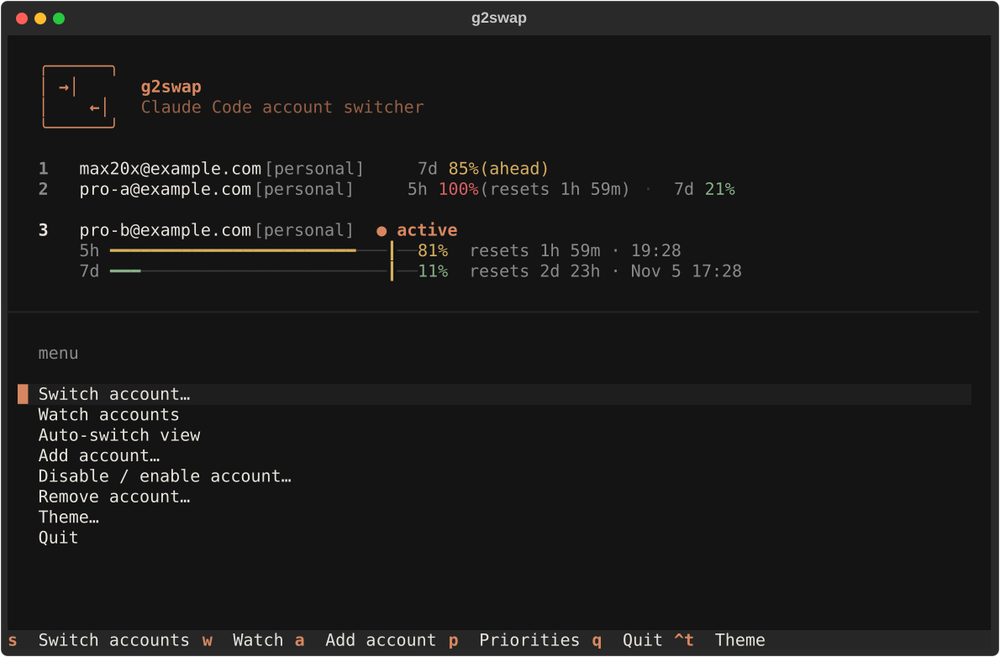
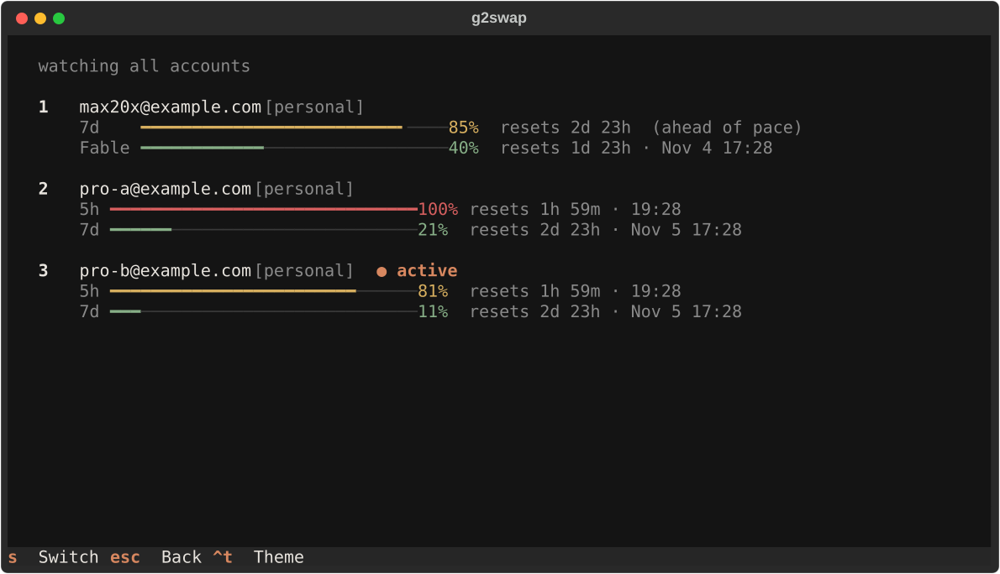

<p align="center">
  <picture>
    <source media="(prefers-color-scheme: dark)" srcset="assets/logo-dark.svg">
    
  </picture>
</p>

<p align="center">
  Multi-account switcher and priority-aware auto-switcher for Claude Code.
</p>

<p align="center">
  <a href="https://github.com/go2digital-org/g2swap/actions/workflows/ci.yml"></a>
  
  
  
  
  
  
</p>

---

g2swap keeps several Claude accounts on one machine and moves between them for you. It drains your smaller plans first, keeps the large plan in reserve, and switches before a session hits a limit.

<p align="center">
  
</p>

## Features

- **Instant switching.** Swap the active login with `g2swap switch`. Open sessions pick up the new token on their next call.
- **Auto-switch daemon.** A background poller watches 5-hour and 7-day usage and moves to the next account at a threshold (default 80%).
- **Priority tiers.** `priority-consume-first` drains your Pro accounts before touching a Max 20x account.
- **Plan detection.** Pro, Max 5x and Max 20x are told apart from the usage shape and ranked automatically.
- **Limit watchdog (macOS).** A 10-second watcher catches a hard limit that lands between two polls, switches immediately and sends a notification.
- **Interactive TUI.** One screen for usage, switching, adding accounts, priorities and the auto-switch toggle.
- **No restart needed.** Claude Code picks up a switch on its next call (on macOS once its Keychain cache expires, about 30 seconds).
- **Parallel sessions.** `g2swap run 2` launches Claude Code as a specific account in the current terminal only.

## Screenshots

<p align="center">
  
</p>

Example accounts shown. Bars turn amber and red as an account approaches its limit.

## Install

macOS, Linux and WSL:

```bash
curl -fsSL \
  https://raw.githubusercontent.com/go2digital-org/g2swap/main/scripts/install/install.sh \
  | bash
```

Windows (PowerShell):

```powershell
$r = "https://raw.githubusercontent.com/go2digital-org/g2swap/main"
irm "$r/scripts/install/install.ps1" | iex
```

The installer sets up `uv`, clones the repository to `~/projects/g2swap`, installs `g2swap` globally, registers the auto-switch daemon (launchd, systemd or Task Scheduler) and adds the `g2swap` shell command. It asks which command name to use (default `g2swap`).

Pass options through the pipe:

```bash
curl -fsSL \
  https://raw.githubusercontent.com/go2digital-org/g2swap/main/scripts/install/install.sh \
  | bash -s -- --alias=gs --no-daemon
```

```powershell
$r = "https://raw.githubusercontent.com/go2digital-org/g2swap/main"
$s = irm "$r/scripts/install/install.ps1"
& ([scriptblock]::Create($s)) -Alias gs -NoDaemon
```

| Option (sh / PowerShell) | Effect |
| --- | --- |
| `--alias=NAME` / `-Alias NAME` | Command name, skips the prompt |
| `--no-alias` / `-NoAlias` | Do not add a shell command |
| `--no-daemon` / `-NoDaemon` | Do not register the auto-switch daemon |

To install from an existing checkout instead, clone the repository and run `./scripts/install/install.sh` (or `.\scripts\install\install.ps1`). It installs from that checkout.

## Quick start

```bash
g2swap add               # log into Claude Code, then store that account
g2swap add               # log into the next account, store it too
g2swap                   # open the dashboard
```

Do not run `/logout` between accounts. Current Claude Code can revoke the refresh token of the account you leave.

## The `g2swap` command

| Command | What it does |
| --- | --- |
| `g2swap` | Open the TUI. Reconnects Remote Control if the active account changed. |
| `g2swap auto [on\|off]` | Toggle the auto-switch daemon, or set it explicitly. Off means manual switching only. |
| `g2swap smart-priority` | Detect each account's plan and set priorities. |
| `g2swap add-account` | Guided flow: log in, store the account, return to the original one. |
| `g2swap <command>` | Anything else runs as a regular command, for example `g2swap list`, `g2swap switch 2` or `g2swap help`. |

In the TUI: `a` adds an account, `p` opens priorities, and the auto-switch screen toggles between **Manual mode** and **Auto-switch on**. Manual switching works in both modes.

## How it works

<p align="center">
  
</p>

- **Account store.** `g2swap add` saves each login as its own backup, so no account ever has to log out.
- **Active login.** A switch copies one backup into the place Claude Code reads its token from. Running sessions pick it up on their next call.
- **Daemon and watchdog.** Both use the same switch logic as `g2swap switch`, including the credential locks Claude Code itself uses, so a swap never collides with a token refresh.
- **Usage data.** The daemon reads 5-hour and 7-day usage from Anthropic's own endpoints over HTTPS and sends nothing anywhere else.

## How auto-switch works

<p align="center">
  
</p>

Priorities decide the order. A higher number is used first, and ties go to the account with the most quota left:

| Account | Plan | Priority |
| --- | --- | --- |
| Slot 1 | Max 20x | 1 (used last) |
| Slot 2 | Pro | 10 |
| Slot 3 | Pro | 10 |

The 5-hour window switches at 80%. Weekly windows get their own, higher line (97%), so a large plan that is 85% through its week is still a valid target. Without it, every account can be "over the line" at once and the auto-switcher holds instead of moving.

Set them by hand with `g2swap priority <slot> <tier>`, or let `g2swap smart-priority` do it. The default strategy and threshold live in the config:

```bash
g2swap config set autoswitch.strategy priority-consume-first
g2swap config set autoswitch.threshold 80          # 5-hour window
g2swap config set autoswitch.weeklyThreshold 97    # 7-day and per-model windows
g2swap config set autoswitch.intervalSeconds 30
```

## Repository layout

```
.
├── src/claude_swap/     Python package: CLI, switcher, auto-switch engine, TUI
│   └── tui/             Textual screens, modals and styles
├── tests/               pytest suite
├── lefthook.yml         Git hook gates
├── scripts/
│   ├── install/         install.sh (macOS / Linux / WSL), install.ps1 (Windows)
│   ├── watchdog/        session-watchdog.sh, the hard-limit safety net
│   └── gates/           Git hook scripts used by lefthook.yml
└── assets/              Logo and TUI screenshots
```

## Development

```bash
uv sync
uv run pytest           # runs in parallel, about 20 seconds
uv run g2swap help
```

### Git hooks

Quality gates run through [lefthook](https://github.com/evilmartians/lefthook). Install the tools once, then enable the hooks:

```bash
brew install lefthook gitleaks typos-cli shellcheck ruff
lefthook install
```

| Stage | Gates |
| --- | --- |
| pre-commit | gitleaks secret scan, typos, ruff lint and format check, shellcheck, no `else` in new files, no credential files |
| commit-msg | rejects attribution trailers and subjects over 72 characters |
| pre-push | full test suite |

Hooks only reject, they never rewrite your files. If formatting fails, run `scripts/gates/format_fix.sh`, review the result and stage it. A gate whose tool is missing skips itself with a message. `git commit --no-verify` bypasses everything, for emergencies only.

## Credits and license

g2swap builds on [claude-swap](https://github.com/realiti4/claude-swap) by Onur Cetinkol, released under the MIT license. The original copyright notice is kept in [LICENSE](LICENSE).

---

<p align="center">a g2x product.</p>
